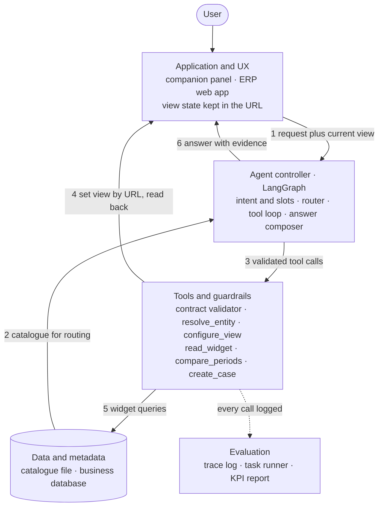
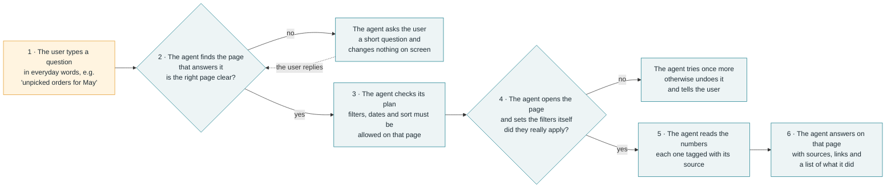

# System Architecture and Implementation Plan

As of 2026-10-05. Drafts submission sections **4. System Architecture and Workflow** and **5. Technology Stack and Implementation Plan**.

**Where the points come from.** Gap IDs (G1.1 to G9.3) are defined in `03_Reference_Stack_Gaps_and_KPI_Impact.md`. Design choices and build pieces come from `04_Gap_Solutions_and_Open_Source_References.md` (hackathon cut) and `04_Proposal_Navigation_Map_and_Routing.md`. Related work comes from `05_Mind2Web_Citing_Work_and_Proposals.md`, which summarises papers from their abstracts only. The plan changes listed in report 05 are built in here: positioning against prior work (4.7), external stand-in benchmarks (4.8), and new KPIs plus the validator ablation (4.6, 5.4).

**Evidence boundary.** Nothing here is built or measured yet. The plan assumes we build our own small web app on the Wide World Importers (WWI) sample database, as in the report 04 hackathon cut, with a team of four and a 48-hour build.

---

## 4. System Architecture and Workflow

### 4.1 Architecture at a glance

The assistant is a companion panel inside a small ERP web app, which we build for **investigating order-fulfilment problems**. The design rests on three ideas:

1. **One catalogue drives both the app and the agent.** A single file defines every page, widget, filter and measure, together with what each one means. The app is rendered from it and the agent reasons over it, so the two cannot drift apart.
2. **The agent acts through state, not clicks.** Page, filters, date range, sort and selection all live in the URL. Navigating and configuring a view is one checked URL change, and data comes from each widget's own query, never from free-form SQL.
3. **Every number carries evidence.** Each tool result has an evidence ID. The answer is checked so that every figure traces to a result. Each statement is labelled as observed, calculated or inferred.

The system has five layers: application and UX, agent controller, tools and guardrails, data and metadata, and evaluation.

### 4.2 Architecture diagram

The diagram is in Mermaid. It renders on GitHub, or paste it into mermaid.live to export a PNG or SVG for the submission. The numbered arrows match the six data-flow steps in 4.4 and the workflow in 4.5. Section 4.3 lists the components inside each block.

### 4.3 Components

Each component is linked to the gaps it closes (report 03), the KPI it serves, and supporting work (report 05 or the Mind2Web review).

**Layer 1: Application and UX**

| Component | What it does | Gaps | KPIs | Supporting work |
|---|---|---|---|---|
| ERP web app | Four pages (Orders, Inventory, Purchasing, Cases), with supplier detail in a side panel. The pages are rendered from the catalogue. Page, filters, date range, sort and selection are URL parameters, so every view is a deep link. | G1.4, G5.1 | Intent → destination, UI-state | Beyond Browsing (API agents beat browsing on WebArena); AutoWebWorld |
| Companion panel | A chat panel docked in the app. It shows each action as it runs and labels each statement as observed, calculated or inferred. Each number links to the view it came from. It renders comparison charts and summary cards, and it asks before any write. Undo returns to the previous URL. | G9.1, G9.2, G9.3 | UX, faithfulness | CowPilot, Magentic-UI |
| Context bridge | Sends the current page, filters and selection with every message, so "this item" or "same period" has a meaning. | G2.2, G3.3 | Intent → destination, multi-step | EmbeWebAgent (URL observations); MT-Mind2Web |

**Layer 2: Agent controller**

| Component | What it does | Gaps | KPIs | Supporting work |
|---|---|---|---|---|
| Intent and slot extraction | Turns the request into an intent and slots (entity, measure, period, filters) and merges in the current context. Relative dates are resolved against the scenario's fixed "today". | G3.3 | UI-state | — |
| Router | Keeps only pages whose grain and filters can take the slots. The LLM then picks from that short list, with a "none of these" option. It asks a question when two candidates tie, and abstains when nothing fits. | G2.1, G2.3, G3.4 | Intent → destination, retrieval, reliability | Mind2Web's MindAct (shortlist, then choose with "none of the above"); Vector canonical intent graphs |
| Tool-calling loop | A plain loop with a step limit. Each next step is chosen from what the tools returned, so it changes course when a result is unexpected. | G3.1 (cheap version) | Multi-step success, step count | "How Fast Do Agents Rot?" (success falls with every extra step) |
| Investigation state | One record per conversation: current view, selected entities and evidence so far. It is checkpointed, so the agent can pause for a question and resume. | G3.3 | Multi-step, UX | — |
| Answer composer and evidence checker | Writes the answer only from tool results. A number that matches no evidence ID blocks the answer until it is redrafted. The word "cause" is allowed only when a linking record is shown; otherwise the answer says "accounts for" or "contributes to". | G6.1, G6.3, G9.1 | Analytical faithfulness | Mind2Web 2 (attribution rubric); AD-Bench |

**Layer 3: Tools and guardrails**

| Component | What it does | Gaps | KPIs | Supporting work |
|---|---|---|---|---|
| Contract validator | Checks every tool call against the catalogue before it runs. The page must exist, each filter must be allowed on that page, values must be in the allowed set, and dependent filters must be present. | G1.3, G3.2 | UI-state, reliability (invented actions) | Typed "web verbs" position paper; CLAIRE (removing validation halved success under stress) |
| `resolve_entity` | Turns names into database IDs by fuzzy matching. Several matches become options for the user. No match is reported as no match. | G2.3, G3.4 | UI-state, reliability | — |
| `configure_view` | Changes the URL, reads back the state the app actually applied and compares the two. On a mismatch it retries once, then restores the previous URL and says so. | G5.2, G5.3 | UI-state, reliability | Hybrid World-Model Planning (claimed vs real state) |
| `read_widget` | Runs the widget's own parameterised query, the same one the screen uses, and returns rows with an evidence ID. | G4.1, G4.2 | Faithfulness | VACP |
| `compare_periods` | Applies one set of filters to two periods. Returns the change and the top contributors per dimension. | G6.1, G6.2 | Faithfulness | AD-Bench, DAComp |
| `create_case` | The only write action. Its confirmation card is built from the exact pending action, not from model text, and the action is checked again just before it is saved. | G5.4 | Reliability (completion under policy) | Verifiable Action Card; Commit-Time Authorization |
| Guarded SQL (optional) | A fallback for questions no widget answers: one SELECT over approved views, checked by SQLGlot, read-only login, row cap. Its answers are labelled "not on screen". | G4.3 | Reliability | — |

**Layer 4: Data and metadata**

| Component | What it does | Gaps | KPIs | Supporting work |
|---|---|---|---|---|
| Catalogue file | Defines routes, pages and widgets; filters with type, allowed values, dependencies and defaults; and measures with grain, unit and formula. It also records meaning: purpose, synonyms, example requests, "use this, not that" notes and what is out of scope. Every description carries a provenance tag: native, corrected or synthetic. | G1.1, G1.2, G1.4 | All routing KPIs | EmbeWebAgent (per-page function registry); ActionEngine (app state machine) |
| App graph | Pages, widgets, filters and drill-down links built in memory from the catalogue. This is the brief's knowledge graph, without a graph database. | G1.3 | Intent → destination | HyMEM; "Web Sitemap Knowledge" (title only, to be checked) |
| Business database | WWI on SQL Server, with a read-only login for the agent. Seeded scenario tables tag every row with its scenario, provenance and seed. There are three or four scenario pairs that differ in one fact, so the correct answer changes. | G4.3, G7.1 | Multi-step, faithfulness | EntWorld (checks results with SQL) |
| Claim checks | SQL assertions, run on every build, that test the riskiest descriptions (backorder direction, carton-to-unit conversion). A description that fails is marked unverified. | G1.2 | Faithfulness | — |
| Search index (optional) | Keyword plus embedding search over a catalogue padded to a few hundred entries. It exists only to measure the retrieval KPI at scale. | G2.1 | Retrieval precision, recall, MRR | Mind2Web candidate ranking; WebLINX |

**Layer 5: Evaluation and observability**

| Component | What it does | Gaps | KPIs | Supporting work |
|---|---|---|---|---|
| Trace log | Records every tool call: its arguments, requested and applied state, evidence IDs, latency and any confirmation. | G8.2 | All | Typed "web verbs" (logging hooks) |
| Task file | About 25 tasks in Mind2Web's format. Each has a goal with no step-by-step wording, a start state, the expected page, the expected final URL state, the expected key intermediate states, expected values with a tolerance, the evidence and the policy. There are three splits: new phrasings, pages with no example requests, and one held-out module. About one request in ten has no page that answers it. Multi-turn tasks follow MT-Mind2Web's patterns (see 4.8): later turns refer back to earlier ones ("this item", "same period"). | G7.2, G8.1 | All | Mind2Web; MT-Mind2Web; BFCL irrelevance category |
| Runner | Replays the tasks, scores the final state rather than the exact click path, and computes every KPI from the log. It also gives partial credit for each key state reached and records where a failed task first went wrong. One flag turns the contract validator off for the ablation in 4.6. | G8.1, G8.2 | All | WebCanvas key states; EntWorld; ST-WebAgentBench; SaaS-Bench (partial credit); WebStep (process metrics); CLAIRE (validation ablation) |
| Drift crawl (optional) | Playwright loads each route and checks that its widgets and filters match the catalogue. It is also the fallback for any action with no URL. | G1.4, G5.1 | Reliability | Prune4Web (fallback only) |

### 4.4 Data flow

The numbers match the arrows in the diagram.

1. **Request:** the user types in the companion panel, which sends the request with the current page, filters and selection.
2. **Route:** the agent extracts intent and slots, and the router picks a page and widget from the catalogue. If nothing fits, it asks or abstains, and nothing changes on screen.
3. **Validate:** every tool call goes through the contract validator first. An invalid call is rejected before it reaches the app or the database. `resolve_entity` turns names into IDs.
4. **Set the view:** `configure_view` sets the new URL and reads back the state the app applied. On a mismatch it retries once, then restores the previous URL and says so.
5. **Read data:** `read_widget` or `compare_periods` runs the widget's own query. Results come back with evidence IDs, and the investigation state is updated.
6. **Answer:** the composer writes the answer, the evidence checker verifies every number, and the panel shows the answer with fact labels, evidence links and the actions taken.

Outside these six steps:

- **Build time:** the app is rendered from the catalogue, and the claim checks run against the database.
- **Writes:** `create_case` runs only after the user approves the confirmation card.
- **Logging:** every call is logged, and the runner replays the task file to compute the KPIs.

### 4.5 User workflow

**One request in six steps.** The user only types a question in everyday words (orange). Every teal step is done by the agent on its own: the user never picks a page or sets a filter. The numbers match the slide's workflow strip.

**An investigation across four turns**

| Turn | User says | What the agent does | What the user sees | Gaps and KPIs exercised |
|---|---|---|---|---|
| 1 | "Show unpicked orders for May." | Resolves "May" on the scenario clock, routes to Orders, sets the status and date filters, reads them back, then reads the widget. | The Orders page with the filters applied, and an answer citing that widget. | G3.2, G5.2 · destination, UI-state |
| 2 | "Which items account for most of the rise compared with April?" | Keeps turn 1's filters, then runs `compare_periods` for April against May and ranks the contributing items. | A comparison card and chart. Figures are labelled calculated, and the wording is "accounts for", not "caused". | G3.3, G6.1, G6.2 · faithfulness |
| 3 | "Show the supplier for this item." | Takes "this item" from turn 2's selection, then opens Purchasing filtered to that item with the supplier panel open. | A deep link to the view. Open purchase orders are described as related supply, not as stock reserved for the order. | G2.2, G3.3 · destination, multi-step |
| 4 | "Open a case for this." | Prepares `create_case` and shows a confirmation card with the exact fields. After approval it checks again, then saves. | The confirmation card, then a link to the new case. | G5.4 · completion under policy |

When nothing in the app can answer a request, the agent says so and suggests the closest question it can answer. It does not navigate anywhere.

### 4.6 How the architecture serves each KPI

| KPI (from the brief) | Components that drive it | How the runner measures it |
|---|---|---|
| Intent-to-destination accuracy | Catalogue meaning, router, context bridge | Top-1 page match, reported separately for each split |
| UI-state correctness | Validator, `configure_view` read-back, `resolve_entity`, date resolution | Exact match of the final URL state, plus F1 for each filter, date and sort value |
| Multi-step task success, steps, latency | Tool loop, investigation state, one URL change per view | Task success, partial credit for key states reached, step count per task, median and 95th-percentile latency |
| Analytical quality and faithfulness | `read_widget`, `compare_periods`, evidence checker, fact labels | Values within tolerance; share of numbers with an evidence ID (target: all) |
| Retrieval quality at scale | Search index over the padded catalogue | Precision, recall and MRR, plus recall@k on a Mind2Web sample (4.8) |
| Reliability and safety | Validator, ask-or-abstain, read-back, confirmation card | Invented-action rate (scored on the no-fit requests); false-state rate (the agent reports a state that read-back contradicts); recovery rate; completion under policy |
| User experience | Panel, deep links, action list | Tasks finished without manual navigation; short ratings from testers outside the team |

**Completion under policy (CuP).** Taken from ST-WebAgentBench. A task counts only if it succeeds **and** respects every policy attached to it: it writes nothing without confirmation, never runs an action the validator rejected, and has no figure without evidence. We report CuP next to raw task success. The gap between the two is the safety cost.

**Step count matters.** "How Fast Do Agents Rot?" reports that task success falls geometrically as steps are added. So we report steps for every task and treat fewer steps as a design goal, not just a latency figure.

**Validator ablation.** The runner runs the task file twice, with the contract validator on and off. It compares UI-state correctness, the invented-action rate and CuP. This shows how much the contracts contribute, following CLAIRE, where removing validation halved success under stress. It costs one flag and one extra run, so it is part of M5 rather than stretch work.

### 4.7 Related systems and what we add

Report 05 found prior work for the "embedded agent" idea, so we don't claim it as new. The deck's alternatives slide uses this table.

| System | What it already does | What we share | What we add |
|---|---|---|---|
| **EmbeWebAgent** (2026) | Embeds an agent in an existing UI through URL and ARIA observations and a per-page function registry. Navigation, manipulation and analytics run as MCP tools. | An agent inside the app that acts through app-level functions, not pixels | Business meaning in the catalogue (grain, unit, valid filter combinations); read-back after each change; evidence-checked analysis |
| **VACP** (2026) | A protocol that makes visual-analytics apps "agent-ready" by exposing state, available interactions and direct execution | Exposing app state and interactions to the agent | Measures defined once and shared with the screen; period comparison with contributor ranking; observed, calculated and inferred labels |
| **Typed actions / "web verbs"** (2026 position paper) | Typed functions with pre- and postconditions, policy tags and logging hooks, in place of clicks | Pydantic-validated tools, read-back as a postcondition, trace log | A working prototype with measured KPIs on an ERP scenario, including a validator ablation |
| **Vector** (2026) | Maps phrasings to stable intent IDs, then routes each by risk and confidence to an API, an agentic read, an agentic write or a manual deep link | Ask or abstain when unsure; different handling for reads and writes | Routing filtered by the slots each page can take; confirmation bound to the exact pending action |

**Our claim in one line:** the agent understands what each view *means*, changes the view only in ways the app allows and checks the result, and reports only numbers that trace to the view they came from.

All four are summarised from abstracts only (report 05). Recheck each paper before the deck cites a specific feature.

### 4.8 External stand-in benchmarks

The brief allows public benchmarks as stand-ins. None of them measures our core KPIs directly, because our agent acts on our own catalogue, not on raw web pages. We use each one for one narrow purpose. Headline numbers come from our own task file.

| Benchmark | What we use it for | Plan | Limit |
|---|---|---|---|
| **EntWorld** (ERP, CRM and ITIL tasks checked with SQL) | Closest public match to our domain | Role D checks the licence and data release in the first hour of M1. If released, we copy its two methods: generating tasks from the schema, and checking results with SQL. If time allows, we also translate a handful of its ERP tasks that our WWI pages can answer into the task file, tagged as a separate source. | Running our agent inside EntWorld's own app would need the Playwright path. That is post-hackathon. |
| **MT-Mind2Web** (multi-turn Mind2Web) | Follow-ups and carry-over (G3.3) | We model our multi-turn tasks on its conversation patterns. We also run its instruction sequences through the context bridge and slot extraction alone, to check that references to earlier turns resolve correctly. | Element-level actions on websites, so it can't score our full agent. It replaces Mind2Web as our multi-turn stand-in. |
| **Mind2Web** (training split, open) | Retrieval stress test (G2.1) | Run 50–100 tasks through our keyword plus embedding ranker over each step's candidate elements, and report recall@k and MRR. No fine-tuning, so there is no leakage. | Single-turn shopping and travel sites, no analytics. Retrieval only. |
| **Online-Mind2Web** | A caution, not a test | We quote no offline benchmark score as evidence of real-world ability. | — |
| **WorkArena** | Design reference for list filtering and dashboard tasks | Not run; access is gated | — |

---

## 5. Technology Stack and Implementation Plan

### 5.1 Technology stack

| Layer | Choice | Why | Licence |
|---|---|---|---|
| Front end | React with Vite | The chat-panel library needs React. Proposed default; swap it for whatever the team knows best. | MIT* |
| Charts and summary cards | Recharts | Draws comparison charts and summary cards on the fly inside the panel. | MIT* |
| Chat panel | CopilotKit, or a small custom panel | Embedded companion with streaming answers and action display. | MIT |
| Back end | FastAPI (Python) | Same language as the agent, with Pydantic built in. | MIT* |
| Agent controller | LangGraph | Tool-calling loop, conversation state, and pausing for a question. From the LangChain family named in the brief. | MIT |
| Tool-argument validation | Pydantic | Generates the contract validator from the catalogue. | MIT |
| Name matching | RapidFuzz | `resolve_entity`. | MIT |
| Relative dates | dateparser | Resolves "May" and "last month" against the scenario clock. | BSD-3-Clause |
| Database | SQL Server with WWI, accessed through pyodbc | Already restored. The agent uses a read-only login. | WWI: Microsoft sample · pyodbc: MIT* |
| Language model | A hosted model with tool calling and structured output | Choice still open (see 5.5). | — |
| Optional extras | bm25s and FlagEmbedding (search index), SQLGlot (guarded SQL), Playwright (drift crawl and fallback) | Only needed for the stretch milestones. | MIT; Playwright Apache-2.0 |

\* Licence from general knowledge, not rechecked today. The others were checked on GitHub in reports 03 and 04.

### 5.2 How this maps to the brief's reference stack

| Brief's reference stack | Our prototype choice | Why |
|---|---|---|
| Application-metadata store | Catalogue file, version-controlled with the code | The app is rendered from it, so it cannot drift (G1.4). |
| Knowledge graph of pages, widgets and filters | Graph built in memory from the catalogue | Same structure. Four pages don't need a graph database. |
| Vector index (FAISS, Milvus or pgvector) | Optional keyword plus embedding index for the retrieval test | At four pages the whole catalogue fits in the prompt (G2.1). An index matters only at hundreds of entries, so we test that separately. |
| Connectors to the platform's APIs | Our own URL state and FastAPI endpoints | One checked URL change replaces a chain of clicks (G5.1). |
| LangChain or LlamaIndex with tool calling | LangGraph | Adds state and pause-for-question on top of tool calling. |
| RAG for page and data-view retrieval | Router: filter by slots, then pick with a "none fits" option | Mind2Web's shortlist-then-choose pattern, with abstention. |
| Text-to-query generation | Named widget queries; guarded SQL only as a fallback | Answers use the same numbers as the screen (G4.1, G4.2). |
| Multi-step reasoning for analysis | Tool loop with a step limit, plus `compare_periods` | Fewer, larger steps. Success falls with every added step. |
| Playwright | Drift crawl and fallback only | Click chains fail most on complex enterprise workflows: UI-CUBE reports 9–19% success. |
| Guardrails and confirmation | Contract validator, two action tiers, confirmation bound to the exact action | Covers G3.2 and G5.4, and is scored by completion under policy. |
| Embedded companion with charts, deep links, human review and explanations | Companion panel with fact labels, action list and confirmation card | Covers G9.1 and G9.2. |

### 5.3 Team responsibilities

In the first hour the team agrees three shared formats: the catalogue schema, the tool input and output schema (including evidence IDs) and the trace-log format. With those fixed, all four people can work in parallel against mock data from the start.

| Role | Owns | Gaps owned | Delivers to the KPI report |
|---|---|---|---|
| **A. App and data** | Catalogue file, the four pages, URL state, read-only database login, widget queries, seeded scenarios, claim checks | G1.1–G1.4, G4.1–G4.3, G7.1 | The app, scenario data and passing claim checks |
| **B. Agent** | LangGraph loop, intent and slots, router, validator, the tools, investigation state | G2.1–G2.3, G3.1–G3.4, G5.2, G5.3 | Destination and UI-state results |
| **C. Companion UX** | Panel, context bridge, fact labels, action list, confirmation card, charts and summary cards, deep links | G5.4 (interface side), G9.1–G9.3 | Latency figures and tester feedback |
| **D. Evaluation and safety** | Task file (multi-turn tasks modelled on MT-Mind2Web), requests collected from people outside the team, runner, trace log, evidence checker, completion-under-policy scoring, validator ablation, the EntWorld check, the alternatives slide (4.7), demo numbers in the deck | G6.3, G7.2, G8.1, G8.2 | The KPI table, including CuP and the ablation |

### 5.4 Timeline

The build window is 48 hours. Each milestone ends with a working demo, so we can stop after any of them.

| Milestone | Hours | Build | Done when | KPIs unlocked |
|---|---|---|---|---|
| **M1 Foundation** | 0–10 | Shared formats agreed in the first hour; EntWorld licence and data checked (role D, first hour); catalogue file; the four pages rendered from it with state in the URL; read-only login; widget queries; claim checks; first 10 tasks | Every view opens from a URL, the claim checks pass, and the EntWorld decision is recorded | Baseline |
| **M2 Act** | 10–20 | Intent and slots, router, validator, `configure_view` with read-back, `read_widget` | "Show unpicked orders for May" works through chat | Destination, UI-state |
| **M3 Context** | 20–28 | Context bridge, investigation state, `resolve_entity`, ask-or-abstain | "Show the supplier for this item" works as a follow-up, and no-fit requests get a question, not an action | Invented-action rate, multi-turn |
| **M4 Analyse** | 28–36 | `compare_periods`, evidence IDs, fact labels, evidence checker, charts and cards, seeded scenario pairs | A period comparison where every number links to a view | Faithfulness |
| **M5 Measure** | 36–42 | `create_case` with confirmation card; runner computing every KPI, including completion under policy, partial credit and step count; validator on/off ablation; task file grown to about 25 tasks with held-out phrasings, no-fit requests and multi-turn tasks modelled on MT-Mind2Web | One command prints the full KPI table and the ablation | All core KPIs |
| **M6 Rehearse** | 42–48 | Demo rehearsal, measured numbers into the deck, buffer for fixes | The demo script runs end to end twice without intervention | — |

Stretch work happens only if we are ahead of schedule: the retrieval test on a padded catalogue and on a Mind2Web sample, guarded SQL, a page-agent baseline, the MT-Mind2Web reference-resolution check, and translated EntWorld tasks if M1 found it usable.

Owners: role A leads M1, role B leads M2 and M3, roles B and C share M4, and role D leads M5. Role C builds the panel against mock tool outputs during M1–M2, and role D writes tasks from the first hour.

### 5.5 Risks and open decisions

| Risk or decision | Effect on the plan | Mitigation |
|---|---|---|
| The organisers supply a platform, or we switch to an existing app (EspoCRM, Appsmith and others in `Potential_applications.md` and report 04 Appendix C) | Design choices 1 and 2 may not hold. If view state is not in the URL, Playwright becomes the main way to act. | Before M1, check that the platform exposes its page definitions and keeps view state in the URL. If not, spend most of M2 on a Playwright action layer and cut M4 to the period comparison alone. |
| Model hosting | A local model needs constrained generation and a different latency plan. | Decide before M2. Keep the model behind one interface so it can be swapped. |
| Database access from Linux | The back end runs on Linux, but SQL Server is a Windows instance. | Create a read-only SQL login in the first hour and test the connection before writing queries. |
| Team-written requests inflate accuracy | Destination accuracy looks better than real use would show (G7.2). | Collect requests from people outside the team and report each source separately. |
| Prior art overlaps our idea | EmbeWebAgent and VACP already embed agents in apps. Typed "web verbs" and Vector propose validated actions and risk-based routing. | Don't claim the embedded agent as new. Claim what 4.7 lists: business-meaning contracts, checked view changes and evidence-traced analysis. Back the claim with the validator ablation. Recheck each paper before citing a specific feature. |
| EntWorld is not released, or its licence forbids our use | No external ERP stand-in | Keep only its method (schema-generated tasks, SQL checks) and cite it. Report our own task file as the main evidence, and say plainly that no public ERP benchmark was run. |
