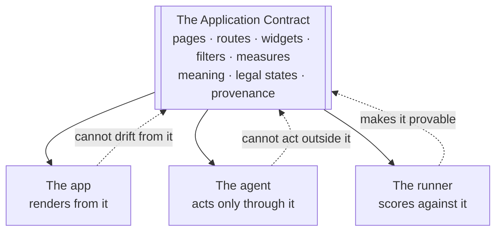

# The Consolidated Solution: One Application Contract

As of 2026-10-05. This is the single statement of our solution. It replaces, for presentation purposes, the scattered versions in reports 03 to 06: report 03 listed the gaps, report 04 proposed fixes one layer at a time, report 05 surveyed the 1,506 papers citing Mind2Web and found the published methods, and report 06 drew the architecture. This document says what the problem really is, what the one answer is, and which published method backs each part of it.

**How to read it.** Section 1 states the problem, section 2 gives the published evidence for it, section 3 states the answer, section 4 gives the six rules that follow from it, and section 5 traces all 28 gaps to the method that fixes each one. Sections 6 to 9 cover positioning, measurement, what we leave out and the build.

**Evidence boundary.** Nothing here is built or measured yet. Every paper below was summarised from its abstract only (report 05), and the figures quoted are the authors' own. Many 2026 entries are preprints that have not been peer-reviewed. Recheck any paper before the deck cites a specific feature of it.

---

## 1. The problem, stated once

A no-code business application shows itself to an agent as **pixels and prose**.

Pixels can be clicked but not checked. Prose describes what a page looks like but not what it means. Everything that goes wrong follows from those two facts:

| Because the app is only pixels | Because the app is only prose |
|---|---|
| The agent clicks through pages instead of setting state, so actions are slow and brittle. | The agent finds the right-looking page and misreads it — orders instead of order lines, cartons instead of units. |
| A filter that fails to apply goes unnoticed, and success is reported anyway. | Near-identical pages crowd each other out, so the wrong one is chosen. |
| There is no list of legal states, so invalid filter combinations are invented. | A number is produced with no way to say which view it came from. |
| Nothing records what the agent did, so nothing can be scored. | "Likely causes" are asserted that the data does not support. |

The 28 gaps in report 03 are all symptoms of this.

## 2. What the literature already settles

We do not have to argue the premise. Three things are established in published work, and a fourth is the opening we are building into.

### 2.1 Driving an app at its surface does not work

| Finding | Source |
|---|---|
| Agents driving real web pages finished **2–7%** of whole tasks. The best fine-tuned model got 39–52% of individual steps right but only 3–5% of complete tasks; GPT-4, on 50 tasks per split, finished 2%. | Mind2Web (2023), the canonical benchmark |
| On enterprise workflows specifically, agents succeed **9–19%** of the time, against 67–85% on single interface interactions — a cliff, not a slope. | UI-CUBE (UiPath, 2025), 226 tasks |
| Even top agents on realistic CRM tasks succeed on **fewer than 40%**. | CRMArena (2025) |
| Task success decays **geometrically** with each added step, governed by a per-step reliability that stays below 1 even for the largest models. Long click chains therefore cannot be fixed by a better model. | How Fast Do Agents Rot? (2026) |
| Agents' **Completion under Policy is under two-thirds** of their nominal completion rate: they finish the task but break the rules on the way. | ST-WebAgentBench (2024), 222 enterprise tasks |
| In adversarial tests, **207 of 216 runs committed an effect after the authorising path had already failed** — approval and action had come apart. | Commit-Time Authorization (2026) |

### 2.2 The bottleneck is grounding, not reasoning

SeeAct ran GPT-4V on Mind2Web and completed **51.1% of tasks on live websites when element grounding was supplied by hand** — far above the fully automatic figures. The model could decide what to do; it could not reliably find the thing to click. Mind2Web's own candidate-ranking step reaches recall@50 of 85–89%, meaning the correct element is usually *somewhere* in a 50-item shortlist but still has to be picked out. Prune4Web attacks the same problem with generated scoring programs for a 25–50× reduction in candidates.

**The conclusion we draw:** if grounding is the bottleneck, remove grounding from the critical path. A declared contract does that — there is nothing to find, because every actionable thing is named.

### 2.3 Going around the surface works measurably better

| Finding | Source |
|---|---|
| API access beat browsing; a hybrid of both beat browsing alone by **24 points absolute** (38.9% success, state of the art at the time) on WebArena. | Beyond Browsing (ACL 2024) |
| Direct cached calls ran in **950 ms against 3,404 ms** for Playwright — 3.6× mean, 5.4× median, over 94 domains. | Unbrowse (2026) |
| A plain agent with a terminal and platform APIs **matched or beat** heavier GUI and MCP architectures at a fraction of the cost. | Terminal Agents Suffice (2026) |
| Declaring app state and interactions to the agent raised success while **cutting tokens and latency** against vision and DOM agents. | VACP (2026) |
| Removing the deterministic validation step **halved success under stress** (1.000 → 0.500). | CLAIRE (2026) |

### 2.4 The opening: nobody is doing this for business applications

Mind2Web has **1,506 citing papers** (53 in 2023, 240 in 2024, 469 in 2025, 699 so far in 2026; 207 marked as influential). We tagged all of them by topic. The field is enormous and almost none of it points at our problem:

| Topic in the citing literature | Papers |
|---|---|
| Enterprise, ERP, CRM or workplace | ~47 |
| Analytics, dashboards or charts | ~85 |
| Text-to-SQL or data agents | ~10 |
| An in-app companion or copilot | ~8 |
| **No-code or low-code platforms** | **1** |

Counts are from a keyword scan of titles and abstracts, so they are indicative rather than exact. The direction is unambiguous: of 1,506 papers, about 40 are relevant to us and exactly one mentions no-code platforms at all. The published work is overwhelmingly about generic web and GUI agents, agent memory and reinforcement learning.

**What this means for us.** The *mechanisms* we need are published and validated — we should borrow them rather than invent. The *combination*, applied to a metadata-defined business application with business meaning and traceable numbers, is not occupied. One further datum makes the product case: in UI-CUBE, **human testers with no prior experience of the application scored only 61.2%**. Business apps are genuinely hard to operate, which is exactly why an assistant that knows the app is worth building.

## 3. The answer, stated once

**Stop presenting the app as pixels and prose. Present it as a contract.**

Write one machine-readable file — the **Application Contract** — that declares, for the whole app:

- every **page and route**, with its typed parameters;
- every **widget**, with the business question it answers, its grain and its unit;
- every **filter**, with its type, allowed values, dependencies and the order it must be set in;
- every **measure**, with one named, parameterised query;
- for each description, where it came from: native, corrected or synthetic.

Then give that one file **three consumers**:

That is the whole idea. **One contract, three consumers.** The app cannot drift from its own description, because it is rendered from it. The agent cannot invent an action, because every call is checked against it first. And the result is provable, because the expected final state is written in the same terms the app applied.

Everything else in our system is a consequence of this choice, not a separate invention.

## 4. The six rules that follow

Each rule is forced by the contract. Each one closes a group of gaps, and each one is already validated in published work.

### Rule 1 — The contract is the only description of the app

The app is rendered from it, so the two cannot disagree. Meaning goes in it, not just shape: purpose, grain, unit, synonyms, "use this page, not that one" notes and what is out of scope. The riskiest claims become SQL assertions that run on every build; a description that fails its check is marked unverified and kept out of the index.

**Published basis.** EmbeWebAgent exposes a per-page function registry to an embedded agent. VACP makes analytics apps "agent-ready" by declaring state and available interactions, and reports higher success with fewer tokens and lower latency than vision or DOM agents. ActionEngine builds a state-machine memory of an app by crawling it offline, storing how the application works rather than solutions to single tasks. "Build the Web for Agents, Not Agents for the Web" argues the general case.

**Closes:** G1.1 shape without meaning · G1.2 wrong metadata · G1.3 no legal states · G1.4 drift.

### Rule 2 — Act by one typed state change, never by a chain of clicks

Page, filters, date range, sort and selection live in the URL. Setting a view is one typed call that changes one URL. Playwright is kept only for drift-checking the app and for any action with no URL.

**Published basis.** *Beyond Browsing* found agents with API access beat browsing agents, and a hybrid of both beat browsing alone by 24 points absolute on WebArena. Unbrowse measured cached direct calls at 950 ms against 3,404 ms for Playwright. *Terminal Agents Suffice for Enterprise Automation* found a plain API-driven agent matched or beat heavier GUI architectures at a fraction of the cost. The typed "web verbs" position paper argues for typed functions over clicks and keystrokes. *How Fast Do Agents Rot?* reports task success decaying geometrically with each added step, which makes step count a design target rather than a side effect. Agent Workflow Memory reached +24.6% relative on Mind2Web and +51.1% on WebArena partly by **reducing the number of steps taken** — further evidence that fewer, larger actions is the lever.

**This is also how we sidestep grounding.** SeeAct showed grounding, not reasoning, is the bottleneck (2.2). A typed state change needs no element to be located, so the bottleneck is designed out instead of being optimised. If a later version needs the browser path, Prune4Web's generated scoring programs (25–50× fewer candidates) and WebLINX's element ranking are the methods to use — but not in this build.

**Closes:** G5.1 fragile browser · G9.3 stacked latency · G3.1 greedy multi-step planning (fewer, larger steps).

### Rule 3 — Check every action twice, and show it

**Before:** a validator rejects any call the contract does not allow — unknown page, filter not available there, value outside the allowed set, missing dependent filter.
**After:** `configure_view` reads back the state the app actually applied and compares it with what was asked. On a mismatch it retries once, then restores the previous URL and says so.
**For writes:** the one write action shows a confirmation card built from the exact pending action, not from model text, and the action is re-checked just before it is saved.
**Throughout:** each step is shown as it runs, and undo is the previous URL.

**Published basis.** CLAIRE separates discovery, mapping, deterministic validation, bounded correction, escalation and audit; removing the validation step halved success under stress. The typed "web verbs" paper proposes exactly this shape — preconditions, postconditions, policy tags and logging hooks. Hybrid World-Model Planning measures a "hallucinated-state rate" and gates the agent's claimed state against a check, which is what read-back does. The Verifiable Action Card rebuilds the approval prompt from the real pending action and re-verifies it at dispatch. Commit-Time Authorization found that in 207 of 216 adversarial runs, agents committed an effect after the authorising path had already failed. CowPilot reached 95% success with humans performing only 15.2% of steps; Magentic-UI and the CHI study "Here, Let Me Help" catalogue how people actually intervene.

**Closes:** G3.2 unchecked slots · G5.2 no check after acting · G5.3 no recovery · G5.4 untiered confirmation · G9.2 explanations only after the fact.

### Rule 4 — Route by what each page can take, and be allowed to say "nothing fits"

Keep only the pages whose grain and filters can accept the request's slots. Let the model choose from that short list, with "none of these" always available. Ask a clarifying question when two candidates tie. Abstain when nothing fits — and change nothing on screen. The current page, filters and selection travel with every message, so "this item" and "same period" have a meaning.

**Published basis.** This is Mind2Web's own MindAct pattern: shortlist candidates with a cheap ranker (recall@50 of 85–89%), then have the model pick from a multiple-choice list including "none of the above". Vector resolves varied phrasings to stable intent IDs and then routes by risk and confidence, reporting routing F1 0.89 over 180 task instances with 24 participants. WebLINX prunes pages by ranking elements for the same reason. MT-Mind2Web and Self-MAP address the multi-turn case, where later instructions depend on earlier ones.

**Closes:** G2.1 near-identical components · G2.2 words without context · G2.3 no "nothing fits" answer · G3.3 no carry-over between turns · G3.4 ambiguity guessed.

### Rule 5 — Every number comes from a named measure and carries an evidence ID

The agent never writes SQL. It names a widget or measure and passes filters; the contract holds the one parameterised query behind it, the same query the screen renders from. Each result carries an evidence ID. The answer is checked before it is shown: a figure that matches no evidence ID blocks the answer. Each statement is labelled observed, calculated or inferred, and the word "cause" is permitted only when a linking record is on screen — otherwise the answer says "accounts for".

**Published basis.** VACP declares the measures an analytics app exposes. AD-Bench scores analytics agents on both answer correctness and how much of the expected tool-call trajectory was covered, and keeps ground truth fresh by replaying expert trajectories. DAComp grades open-ended analysis against hierarchical rubrics rather than accepting free prose. A guarded single-SELECT fallback over approved views, labelled "not on screen", stays available for questions no widget answers.

**Closes:** G4.1 valid SQL with wrong meaning · G4.2 query numbers differing from the screen · G4.3 weak SQL safety · G6.1 false cause and effect · G6.2 inconsistent comparisons · G6.3 faithfulness not built in · G9.1 fact and inference unlabelled.

### Rule 6 — Score the final state, not the click path

Each task names a goal in plain words, a start state, the expected page, the expected final state, the expected key intermediate states, expected values with a tolerance, the required evidence and the policies that apply. The runner replays them and computes every KPI from the trace log. Alternative action orders are accepted. Alongside raw success we report **completion under policy**, partial credit for key states reached, step count, and the point at which a failed task first went wrong.

**Published basis.** EntWorld generates enterprise tasks from the database schema and verifies them deterministically with SQL across 1,756 tasks in six domains including ERP. WebCanvas scores 2,439 key intermediate states instead of exact action matches. ST-WebAgentBench pairs each of 222 enterprise tasks with explicit policies and defines Completion under Policy, finding agents' CuP to be under two-thirds of their nominal completion rate. SaaS-Bench gives weighted partial credit for progress. WebStep tracks semantic state alongside the GUI to show where agents diverge. *An Illusion of Progress?* is the warning: offline benchmark scores overstated real-world ability, so we quote none as evidence of it.

**Closes:** G7.1 thin synthetic data · G7.2 team-written utterances · G8.1 benchmarks as stand-ins only · G8.2 undefined KPIs and no action trace.

## 5. Every gap, and the method that fixes it

All 28 gaps from report 03. "Where the method comes from" names the published work that validates the mechanism, not a paper we are copying code from.

| Gap | The problem | What we do about it | Where the method comes from |
|---|---|---|---|
| G1.1 | Metadata gives shape, not meaning | Contract records purpose, grain, unit, synonyms and "use this, not that" notes | VACP; EmbeWebAgent registry |
| G1.2 | Exported metadata can be wrong | Provenance tag per description; SQL claim checks on every build; failures marked unverified | CLAIRE (deterministic validation); BIRD-style evidence profiling |
| G1.3 | No record of which states are legal | Filter types, allowed values, dependencies and setting order declared in the contract | ActionEngine (state machine); AutoWebWorld (FSM) |
| G1.4 | The description drifts from the app | The app is rendered from the contract; optional Playwright crawl checks the rendered app against it | EmbeWebAgent; ActionEngine offline crawl |
| G2.1 | Near-identical pages crowd each other out | Structural filter by slots, then a short multiple-choice list with "none of these" | Mind2Web MindAct (recall@50 85–89%) |
| G2.2 | Retrieval sees words, not context | Current page, filters and selection sent with every message | EmbeWebAgent (URL observations); Vector (context enrichment) |
| G2.3 | A page is always returned | Abstain, and report "no matching view" as a valid outcome | MindAct "none of the above"; Vector risk routing |
| G3.1 | Greedy single-intent planning | Tool loop with a step limit; next step chosen from the last result; fewer, larger steps | How Fast Do Agents Rot?; Agent Workflow Memory |
| G3.2 | Slot values never checked | Contract validator runs before every call | Typed web verbs (preconditions); CLAIRE ablation |
| G3.3 | Context lost on follow-ups | Investigation state carries view, selection and evidence across turns | MT-Mind2Web / Self-MAP |
| G3.4 | Ambiguity guessed instead of asked | Clarifying question when candidates tie or a name resolves to several entities | Vector (confidence routing); CowPilot |
| G4.1 | Valid SQL, wrong meaning | No free SQL. One named parameterised query per measure, with grain and unit declared | VACP; headless-BI practice |
| G4.2 | Query numbers differ from the screen | `read_widget` runs the same query the screen renders from | VACP; AD-Bench |
| G4.3 | Weak query safety | Read-only login; guarded single SELECT over approved views only, with a row cap | — (standard practice) |
| G5.1 | Fragile browser automation | One typed URL state change instead of a click chain; Playwright for drift and fallback only | Beyond Browsing (+24 pts); Unbrowse (3.6×); UI-CUBE (9–19%) |
| G5.2 | No check after acting | Read back the applied state and compare it with the request | Hybrid World-Model Planning; typed verbs (postconditions) |
| G5.3 | No recovery path | Retry once, then restore the previous URL and report the failure | CLAIRE (bounded correction, escalation) |
| G5.4 | All-or-nothing confirmation | Two tiers. The one write shows a card built from the exact pending action and re-checks at save | Verifiable Action Card; Commit-Time Authorization |
| G6.1 | False cause and effect | `compare_periods` returns ranked contributors; "cause" only with a linking record on screen | AD-Bench; DAComp rubrics |
| G6.2 | Inconsistent comparisons | One filter set applied to both periods, with grain and unit fixed by the contract | VACP; AD-Bench |
| G6.3 | Faithfulness not built in | Evidence ID on every result; a number without one blocks the answer | Mind2Web 2 attribution; DAComp |
| G7.1 | Synthetic data lacks edge cases | Scenario pairs differing in one fact, so the correct answer changes; invariants checked on seed | EntWorld (schema-grounded generation) |
| G7.2 | Utterances written by the team | Requests collected from people outside the team; held-out paraphrase split; sources reported separately | Online-Mind2Web (realistic task sourcing) |
| G8.1 | Public benchmarks are only stand-ins | Our own task file scored on final state; each public set used for one narrow purpose (section 7) | EntWorld; WebCanvas; ST-WebAgentBench |
| G8.2 | KPIs undefined, no action trace | Trace log of every call, with requested and applied state, evidence IDs and latency; KPIs computed from it | Typed verbs (logging hooks); WebStep (process metrics) |
| G9.1 | Fact and inference unlabelled | Observed, calculated and inferred badges; every number links to its view | DAComp; Mind2Web 2 |
| G9.2 | Explanations only after the fact | Each step shown as it runs; confirmation before the write; undo is the previous URL | CowPilot (95% / 15.2%); Magentic-UI; "Here, Let Me Help" |
| G9.3 | Latency stacks up | One URL change per view; streamed answers; latency measured and reported | Unbrowse (950 ms vs 3,404 ms); VACP (lower latency) |

## 6. What is borrowed and what is ours

Report 05 found that the "embedded agent" idea is not new. We do not claim it.

| Already published | What we add |
|---|---|
| **EmbeWebAgent** — an agent embedded in a real UI, acting through a per-page function registry | Business **meaning** in the same contract: grain, unit, valid filter combinations |
| **VACP** — analytics apps declaring their state and interactions to an agent | **Evidence-traced** analysis: an ID on every result and a check that blocks unsupported numbers |
| **Typed web verbs** — typed functions with pre- and postconditions in place of clicks | A **working ERP prototype with measured KPIs**, including a validator on/off ablation |
| **Vector** — intent IDs with risk-based routing | Routing filtered by **what each page can actually accept**, and confirmation bound to the exact pending action |

**Our claim in one line:** the agent understands what each view *means*, changes the view only in ways the app declares legal and verifies the result, and reports only numbers that trace back to the view they came from.

**Why the claim is defensible.** Of 1,506 papers citing the canonical web-agent benchmark, about 40 touch enterprise applications or analytics and exactly one mentions no-code platforms (2.4). The individual mechanisms are published, so we are not claiming invention. What is unoccupied is the combination: contract-declared business meaning, verified state changes and evidence-traced analysis, on a metadata-defined business application. We say that plainly rather than overclaiming.

## 7. How we will prove it

Headline numbers come from our own task file, because no public benchmark measures an agent acting on our own contract. Each public set is used for one narrow purpose and labelled as such.

| KPI from the brief | How it is measured |
|---|---|
| Intent-to-destination accuracy | Top-1 page match, reported per split (new phrasings, pages with no examples, held-out module) |
| UI-state correctness | Exact match of the final state, plus F1 per filter, date and sort value |
| Multi-step success, steps, latency | Task success, partial credit per key state, step count, median and 95th-percentile latency |
| Analytical quality and faithfulness | Values within tolerance; share of numbers carrying an evidence ID (target: all) |
| Retrieval quality at scale | Precision, recall and MRR over a catalogue padded to a few hundred entries, plus recall@k on a Mind2Web sample |
| Reliability and safety | Invented-action rate on no-fit requests; false-state rate; recovery rate; completion under policy |
| User experience | Tasks completed without manual navigation; ratings from testers outside the team |

**Three measurements that make the case, not just the demo:**

1. **Validator on versus off.** The same task file run twice. Following CLAIRE, where removing validation halved success under stress, this shows the contract is doing the work.
2. **Completion under policy beside raw success.** From ST-WebAgentBench. The gap between the two is the safety cost, and we report it rather than hiding it.
3. **Invented-action rate on requests nothing can answer.** About one request in ten has no page that answers it. Abstention is the correct behaviour, and this is where a contract-bound agent should beat a free one outright.

**External stand-ins, each for one purpose:** EntWorld for its schema-generated, SQL-verified ERP tasks (licence to be checked in the first hour of the build); MT-Mind2Web for multi-turn carry-over; Mind2Web's open training split for the retrieval stress test only; Online-Mind2Web as a caution against quoting offline scores; WorkArena as a design reference, since access is gated.

### 7.1 Why Mind2Web itself cannot be our benchmark

This matters because Mind2Web is the obvious thing a judge will ask about. It is 2,350 tasks over 137 websites and 31 domains, with about 1,135 elements per page and 7.3 actions per task, under CC-BY-4.0 (6.74 GB; the training split is open, the test splits are gated). It is well built. It also excludes, by its authors' own account, the four things our agent is for:

| Mind2Web's stated limitation | Why it rules the benchmark out for us |
|---|---|
| Evaluation runs on **cached offline pages** | Our central mechanism is reading back the state the app actually applied. Nothing can be read back from a saved page. |
| Modelling is **text-only**, scoring the exact recorded element and operation | We score the final state and accept alternative action orders, because several routes to the same view are equally correct. |
| Each task is **a single instruction given up front**, with no back-and-forth | Half our value is follow-ups — "this item", "same period" — and clarifying questions. MT-Mind2Web, not Mind2Web, is the stand-in for that. |
| There are **no answer-seeking tasks**: it scores interaction, not information | Our KPIs include analytical correctness and whether every number traces to a view. Mind2Web never asks the agent to report a number. |

Its domains are Travel, Shopping, Service, Entertainment and Information — no ERP, no dashboards, no data grids. So we use it for one thing only: a retrieval stress test on the open training split, measuring recall@k and MRR over each step's candidate elements. Picking one element out of ~1,135 is a fair proxy for picking one widget out of hundreds, and since we fine-tune nothing there is no leakage concern. We cite its MindAct pattern — shortlist cheaply, then choose from a multiple-choice list with "none of the above" — as the published basis for our router (Rule 4), and its 2–7% task completion as evidence for Rule 2.

## 8. What we leave out on purpose

The contract makes several things in the brief's reference stack unnecessary at four pages. Each one has a published method waiting if the app grows, and this is the future-work slide.

| Left out | Why it is not needed now | The method to use later |
|---|---|---|
| Vector database (FAISS, Milvus, pgvector) | The whole contract fits in the prompt, so there is no retrieval step to get wrong | Keyword plus embedding search; MindAct-style shortlist-then-choose at hundreds of components |
| Graph database | The app graph is built in memory from the contract | HyMEM's graph memory, which couples symbolic nodes with trajectory embeddings |
| Learned workflow reuse | Four pages and a step-limited loop do not need it | Agent Workflow Memory (induce reusable workflows: +24.6% / +51.1%); Synapse (state abstraction and whole-trajectory exemplars); TRAD (step-wise retrieval, deployed in production RPA at an insurer) |
| Browser automation as the main action path | Every view is a URL | Prune4Web for DOM pruning, guided by the contract rather than free exploration |
| A separate planner | Branches follow from what the tools return | Published planner and world-model work, including the consistency gate in Hybrid World-Model Planning |
| Semantic-layer engine | The contract *is* a small semantic layer | Cube or an Ibis-based layer, once measures outgrow one file |

## 9. Build order

The contract comes first, because everything else reads from it. Each milestone ends in a working demo, so we can stop after any of them.

| # | Hours | Build | Done when |
|---|---|---|---|
| **M1** | 0–10 | Shared formats agreed; the contract file; four pages rendered from it with state in the URL; read-only login; widget queries; claim checks; first 10 tasks; EntWorld licence checked | Every view opens from a URL and the claim checks pass |
| **M2** | 10–20 | Intent and slots, router, validator, `configure_view` with read-back, `read_widget` | "Show unpicked orders for May" works through chat |
| **M3** | 20–28 | Context bridge, investigation state, `resolve_entity`, ask-or-abstain | "Show the supplier for this item" works as a follow-up, and no-fit requests get a question |
| **M4** | 28–36 | `compare_periods`, evidence IDs, fact labels, evidence checker, charts, scenario pairs | A period comparison where every number links to a view |
| **M5** | 36–42 | `create_case` with its confirmation card; the runner and all KPIs; the validator ablation; task file grown to ~25 | One command prints the KPI table and the ablation |
| **M6** | 42–48 | Rehearsal, measured numbers into the deck, buffer | The demo runs end to end twice without intervention |

The full architecture, component tables, technology stack, team split and risk register are in `06_System_Architecture_and_Implementation_Plan.md`. The gap definitions are in report 03, and the papers behind every citation above are in report 05 with the complete citing-paper list in `data/mind2web_citing_papers.csv`.
